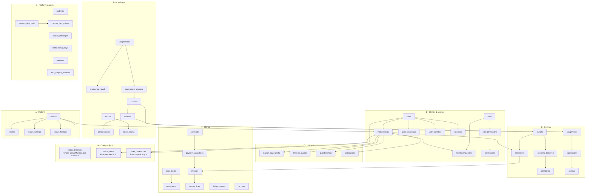

# schema-v2 — the platform data model

**Status:** design, awaiting sign-off (ETL milestone **M0**, register gate **G1**).
**Supersedes:** the v1 schema (108 tables, migrations 1→81).
**Deliverables:** this document · `db/schema-v2.sql` (canonical MySQL, 64 tables) ·
`db/schema-v2-sqlite.sql` (generated mirror) · `api/tools/schema-v2-sqlite.php`
(the generator) · `api/tests/test_schema_v2.php` (executes it).

**Verified, not asserted.** The schema is not a document here: `test_schema_v2.php`
builds the mirror in memory, drives a complete learner journey through it —
tenant → person → membership → catalogue → cohort → enrolment → session →
attendance → invoice → payment → balanced ledger — and then attempts thirty-one
things this design says are impossible, asserting each is *rejected*. It also
fails the build if the mirror has drifted from the canonical file, which is
exactly how v1's two schema files fell out of step. That pass found six real
defects — five of them the same NULL-in-a-unique-key trap, one of which would
have let a retried payment webhook be processed twice. §4.7 is the one worth
reading.

---

## 0 · What changes, and why it is more than a tidy-up

The v1 schema grew a table at a time under delivery pressure, and it shows in
four specific ways. Each has cost real money or real correctness, and each is
fixed structurally here rather than by convention:

| v1 problem | Consequence seen in production | v2 answer |
|---|---|---|
| Two parallel enrolment models (`classes`+`enrollments` vs `cohorts`+`course_enrollments`) | Every read path had to dual-read; a student could exist in one and not the other | **One delivery spine.** `cohorts` + `enrolments` only. |
| Three intake tables (`applications`, `summer_applications`, `scholarship_applications`) | Three status vocabularies, three admin screens, no single funnel view | **One intake** with a `type` + typed payload. |
| Money as a bare `amount` meaning naira on one row and dollars on the next | `SUM(amount)` added naira to dollars; the Revenue KPI reported nonsense until v61 | **Minor units + explicit currency + frozen FX**, enforced by a CHECK. |
| Enum sprawl — application status, enrolment status, cohort status, payment status, all unrelated | No way to ask "where is this person in their journey" | **One lifecycle spine**: a cached stage plus an append-only event log. |

And one change that is not a fix but a widening of scope:

> **The system is multi-tenant from the first row.** Every domain table carries
> `tenant_id`. MAM Academy becomes tenant #1 rather than the hardcoded universe.

That single decision is what makes this a platform rather than one academy's
database, and it is the one thing that cannot be retrofitted cheaply later —
adding a tenant column to a mature schema means touching every query, every
index and every uniqueness constraint in the system.

---

## 1 · Principles

1. **A row's tenant is part of its identity.** `tenant_id` is not a filter you
   remember to apply; it is the leading column of every composite unique key and
   most indexes, so a cross-tenant collision is a constraint violation rather
   than a leak.
2. **Facts are append-only; state is derived and cached.** Lifecycle, money and
   audit are event logs. Current stage / balance / status are materialised for
   query speed and can always be rebuilt from the events.
3. **Nothing is deleted.** `deleted_at` everywhere, with uniqueness scoped so a
   soft-deleted row does not block reuse of its natural key — scoped by
   `deleted_seq`, not by `deleted_at`; see §4.7 for why that distinction is the
   difference between the rule working and silently not working.
4. **Money is never a float, and never bare.** Integer minor units, an ISO-4217
   code, and — for anything cross-currency — the base-currency amount with the
   rate frozen at the moment of the transaction.
5. **Identity is global; membership is tenant-scoped.** One human, one `users`
   row, however many academies they belong to.
6. **Authorisation is data, not code.** Roles and permissions are rows, so a new
   tenant can define "Head of Strings" without a deployment.
7. **Public identifiers are opaque.** Sequential integers stay internal; every
   externally-visible reference is a ULID, so URLs and exports leak neither row
   counts nor growth rate.
8. **Extensibility without DDL.** Tenants add their own fields through a
   registered custom-field definition, not by altering tables.

---

## 2 · Conventions

These are enforced by review, and most are mechanically checkable.

**Naming.** `snake_case`; tables plural; join tables `a_b`; booleans `is_*`;
timestamps `*_at`; money `*_minor` with a sibling `*_currency`.

**Keys.** `id BIGINT UNSIGNED AUTO_INCREMENT` internal PK. `public_id CHAR(26)`
ULID, unique, for every externally-addressable entity. Foreign keys named
`fk_<table>_<column>`; indexes `ix_<table>_<cols>`; uniques `uq_<table>_<cols>`.

**Every domain table carries:**

```
tenant_id     BIGINT UNSIGNED NOT NULL      -- leading column of composite keys
created_at    DATETIME(3) NOT NULL
updated_at    DATETIME(3) NOT NULL
deleted_at    DATETIME(3) NULL              -- soft delete (the human fact)
deleted_seq   BIGINT UNSIGNED NOT NULL DEFAULT 0  -- soft delete (the key scope)
created_by    BIGINT UNSIGNED NULL          -- users(id), nullable: system acts too
updated_by    BIGINT UNSIGNED NULL
row_version   INT UNSIGNED NOT NULL DEFAULT 1  -- optimistic locking
```

`row_version` exists because two admins editing the same cohort is a routine
event, and last-write-wins silently discards one of them. An UPDATE carries the
version it read; a mismatch is a 409, not a lost edit.

**Time.** `DATETIME(3)` in UTC, always. Local wall-clock times that must survive
a timezone change (a class at "16:00 Lagos") are stored as a local time plus an
IANA zone on the owning row, never as a UTC instant — the instant changes when
the offset rules change, the lesson time does not.

**Deletes.** `RESTRICT` by default. `CASCADE` only where the child is
meaningless without the parent (a rubric criterion without its rubric). Never
`SET NULL` on an actor column that an audit row depends on — that erases who
acted, which is the one thing an audit trail exists to record.

---

## 3 · The layers



---

## 4 · The decisions worth arguing about

### 4.1 Global users, tenant-scoped membership

A person is one `users` row with one email, and a `memberships` row per tenant
they belong to. The alternative — a users row per tenant — is simpler until the
first instructor teaches at two centres, at which point they have two passwords,
two profiles, and no way to see both timetables.

Consequences accepted deliberately:
- Email is globally unique, so two tenants cannot independently own the same
  address. This is correct: the address identifies a human, not a relationship.
- Roles hang off the **membership**, not the user, so the same person can be a
  student at one tenant and an administrator at another.
- Deactivating someone at one tenant does not touch their access elsewhere.

### 4.2 Lifecycle as an event log with a cached stage

`lifecycle_events` is append-only: `(membership, from_stage, to_stage, reason,
occurred_at, actor)`. `memberships.stage` caches the current value for indexing
and listing.

The cache is a denormalisation and is allowed to be rebuilt — a `stage` that
disagrees with its event log is a bug in the writer, and a reconciliation job
can prove it. The alternative (deriving the stage on every read) makes the
pipeline board's "everyone at stage X, sorted by age in stage" query
unaffordable.

Stages: `prospect → applicant → admitted → enrolled → active → paused →
alumnus`, plus terminal `withdrawn` and `rejected`. Transitions are validated in
code against a table of legal moves, and every attempt — legal or not — writes
an event.

### 4.3 Money: three columns, one invariant

```
amount_minor      BIGINT NOT NULL       -- 1234 = ₦12.34 or $12.34
currency          CHAR(3) NOT NULL      -- ISO 4217
base_amount_minor BIGINT NULL           -- the same value in the tenant's base currency
fx_rate           DECIMAL(18,8) NULL    -- frozen at transaction time
fx_source         VARCHAR(32) NULL      -- which feed, so a dispute is answerable
```

The invariant, enforced by CHECK: if `currency <> base_currency` then
`base_amount_minor` and `fx_rate` must both be present. That is the constraint
v1 lacked, and it is why `SUM(amount)` could add naira to dollars.

Minor units are stored, not derived, because currencies disagree about how many
there are — JPY has none, KWD has three. `currencies` carries the exponent.

A `ledger_entries` table records every movement double-entry style
(debit/credit, always balancing per transaction). Invoices and payments are
documents; the ledger is the truth. This is the piece that makes the finance
question "why does this student owe ₦8,000" answerable without archaeology.

### 4.4 Tamper-evident audit

`audit_log` rows carry `prev_hash` and `row_hash`, where
`row_hash = sha256(prev_hash || canonical(row))`. Any retro-edit or deletion
breaks the chain from that point, and a verifier can prove the log intact.

This costs one hash per write and makes the audit trail evidence rather than a
convenience. For an academy issuing certificates and charging fees, that is the
difference between "our records say" and "our records can be shown not to have
been altered".

### 4.5 The outbox

Anything that must reach the outside world — a receipt email, a webhook, a
Meet reconciliation pull — is written to `outbox_messages` **in the same
transaction as the state change that caused it**, then delivered by a worker.

This removes the failure v1 has today: a payment settles, the email send throws,
and the two facts disagree with nobody able to say which happened. With an
outbox, either both commit or neither does, and delivery retries independently.

### 4.6 Extensibility without DDL

`custom_field_defs` registers a field per tenant (key, label, data type,
validation, which entity it attaches to); `custom_field_values` stores instances.
This is a deliberate, *bounded* EAV: the definition table constrains type and
validation, so it is not an untyped bag. It exists so onboarding a second
academy that tracks, say, "Suzuki book number" does not require a migration.

### 4.7 Soft delete needs two columns, not one

The obvious spelling of "a deleted row must not block reuse of its natural key"
is to end the unique index with the nullable `deleted_at`:

```sql
UNIQUE KEY uq_enrolments (cohort_id, membership_id, deleted_at)   -- WRONG
```

That constraint does not do what it reads as. **Both MySQL and SQLite treat
NULLs as distinct inside a unique index**, so every live row — all of which have
`deleted_at IS NULL` — is unique against every other live row. The key permits
exactly the duplicate it was written to prevent, and only starts working once
the rows are deleted.

This was caught by writing the test before believing the schema: the first run
of `test_schema_v2.php` inserted a second live enrolment for the same learner in
the same cohort, and a second membership for one user at one tenant, and the
database accepted both. That is v1's two-enrolment-models bug reappearing as a
constraint that looked correct.

So uniqueness is scoped by a companion column:

```
deleted_seq BIGINT UNSIGNED NOT NULL DEFAULT 0   -- 0 while live, row id once deleted
```

`NOT NULL` is the whole point — live rows all carry 0 and therefore collide,
while each deleted row takes a distinct value and blocks nothing. Setting it to
the row id rather than to a flag matters too: a learner who withdraws and
returns three times needs the key recycled three times, and a boolean sentinel
would fail on the second.

`deleted_at` stays, because *when* something was deleted is a real fact that a
data-subject request and an audit both need. The two columns are set together;
`deleted_seq` is the index's business and `deleted_at` is the human's.

**This generalises, and it had to.** The same trap reappeared three more times
once the test could see it — `roles.tenant_id`, `idempotency_keys.tenant_id` and
`status_definitions.tenant_id`, all of which use NULL to mean "platform-wide".
In each case the unique key stopped constraining exactly the rows that most
needed it: five platform roles could be called `admin`, five conflicting
definitions of one status could coexist, and — the serious one — **a retried
payment webhook would insert a second idempotency row and be processed twice.**
Idempotency that only works for tenant-scoped callers is not idempotency.

So the convention is now explicit: **a nullable column may appear in a unique
key only when NULL means "exempt from this constraint"** (a payment with no
provider reference, a notification that should not be deduped). When NULL means
"the default/platform one", it needs a NOT NULL `*_scope` companion — `0` for
the default, the id otherwise.

`test_schema_v2.php` enforces this mechanically: every nullable column inside a
unique index must be registered with a sentence saying why NULL is safe there,
and an unregistered one fails the build. A companion check bans nullable columns
from primary keys outright, because **MySQL coerces PK columns to NOT NULL and
SQLite does not** — `programme_courses` had one, so MySQL would have rejected
every level-less row while SQLite stored them and permitted duplicates. Two
engines disagreeing about what a table means is worse than either behaviour.

### 4.8 Layer H — the schema knows enough to explain itself

Every layer above records what is **true**. Layer H records what a person can be
**told**, and it exists because v1 could not answer three questions that every
user of the system asks. None of these are presentation problems; each one is
missing data that no amount of front-end work can supply.

**"What does this word mean?"** v1 leaked its internal status vocabulary
straight into the portal. A learner shown `carried_forward` or `developing` has
no way to know whether that is good news, and each screen invented its own gloss
— so the same status read differently in three places.

`status_definitions` is one glossary, keyed by `(entity, status, audience,
locale)`. The audience dimension is the part a single `label` column cannot do:
a learner is told *"You have more time on this module — it moves with you rather
than counting against you"*, and their guardian is told *"Their instructor has
given more time. This is a normal part of the pace, not a failure."* Same fact,
different reader. Each row also carries `next_step` (or an explicit NULL, when
the honest answer is "nothing, we will contact you" — worth saying), a `tone`
from a fixed palette so a status is never green on one screen and red on
another, and `is_actionable`, because a reader shown an unactionable state
alongside actionable ones will try to act on it. A tenant row overrides the
platform default, so an academy can use its own words without a deployment.

**"What do I need to do?"** v1's portal could list classes, invoices and
announcements, but nothing could say *"you have two things to do"* — no table
held the union. A learner's outstanding invoice, an instructor's overdue
progress report, a guardian's unsigned consent and an admin's unassigned
application are the same shape of fact.

`action_items` is that one list, for every role. Titles are written for the
reader (*"Pay your September tuition"*, never `invoice.outstanding`) and carry a
`detail` saying why it matters, since an instruction without a consequence gets
deferred. `action_label` is the button's actual words — *"Pay ₦120,000"* tells
the reader something *"Open"* does not. `is_blocking` is deliberately rare: a
list where everything blocks has no priority at all. And `dedupe_key` stops a
nightly sweep stacking five copies of the same task, which is the failure that
turns a to-do list into noise people learn to ignore.

**"Why did that happen?"** v1 allowed a rejected application, a withdrawn
enrolment, a cancelled session, a voided invoice, a failed payment and a waived
charge to be recorded with **no reason at all** — so the notification had nothing
to say and the person had to telephone somebody. Six CHECK constraints now make
the reason a condition of entering the state. They block silence, not the
operation: the same statement succeeds the moment a reason is supplied.

The one worth calling out is `payments.failure_reason`. v1 stored neither the
provider's code nor a plain-language rendering, so *"your payment did not go
through"* was the whole of what a learner could be told — and they would simply
retry the same card and fail identically.

**Two supporting pieces.** `user_preferences` is keyed to the *user*, not the
membership: someone who needs a dyslexia-friendly face or 150% text needs it at
every academy they belong to, and it is stored server-side so it reaches
server-rendered pages and email rather than living in one browser's
localStorage. It also carries `display_currency`, because accounting in the
tenant's base currency is right and showing a guardian in Lagos a USD figure
reads as a pricing error. And `guardianships.scope` is a named level
(`billing_only` / `standard` / `full`) rather than free-form JSON alone, so both
the guardian and the learner can be shown what is shared in one sentence — which
is a safeguarding requirement as much as a clarity one.

Finally, anything a person might quote on the phone now has a human reference:
`memberships.reference`, `applications.reference`, `cohorts.reference`,
`invoices.number`. In v1 only scholarship applicants had one, so every other
caller could offer nothing but their name.

> **Scope note.** This layer makes clarity *possible*; it does not deliver it.
> The portals and admin screens still have to read the glossary instead of
> printing raw status strings, render `action_items` as the one to-do list, and
> honour `user_preferences`. That is UI work against v2, sequenced after the
> ETL load — but it could not have been done at all against v1's tables.

---

## 5 · What is deliberately NOT changing

The plan's principle — *keep the engine, replace the structure* — holds:

- **Business logic, RBAC semantics, payment settlement, state machines** are
  repointed, not rewritten.
- **The test suite** (2,653 assertions) is the acceptance criterion for the
  load: `verify.php` runs it against the loaded v2 database.
- **The security posture** (bcrypt + rehash, hashed session tokens, CSRF on
  mutations, HMAC webhooks, SSRF guard, rate limiting) carries over unchanged.

---

## 6 · Migration stance

v2 is a **fresh database**, not a migration target. `MAM_SCHEMA_TARGET` resets
to a clean v2 baseline: a new install creates the target schema directly rather
than replaying 81 historical migrations. The ETL moves the data.

Reference/config tables (`programmes`, `levels`, `courses`, `currencies`,
`permissions`, `roles`) are **re-seeded from canonical definitions** rather than
copied, shedding accumulated inconsistency. Identity, money, audit and consent
rows are **row-preserving** — every source row lands or is logged as an explicit
reasoned drop, and `verify.php` gates on it.

---

## 7 · Open questions for sign-off

1. **Base currency per tenant or per platform?** Modelled per tenant
   (`tenants.base_currency`). Finance should confirm reporting is expected in
   tenant base, not a single platform currency.
2. **Do guardians need their own login, or is a scoped link enough?** Modelled
   as full memberships with a `guardian` role, which is heavier but means a
   guardian of children at two academies works correctly.
3. **Retention periods per entity** — the columns exist
   (`data_subject_requests`, `consents`); the actual periods are a DPO decision
   and are configured, not hardcoded.
4. **Is `centres` a hierarchy?** Currently flat per tenant. If a tenant needs
   region → centre → room, that is a `parent_id` away, but it should be decided
   before data lands.
